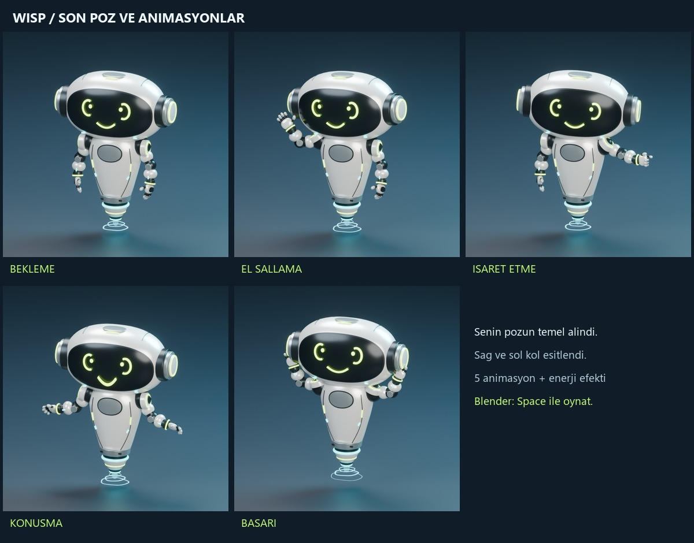

# WISP — animasyonlu eğitim maskotu

Son elle düzenlenen kol pozu iki tarafa eşitlendi. Avuç içleri gövdeye bakar;
parmak hareketleri, yüze oturan kavisli ekran ve alttaki enerji dalgaları korunur.



## Dosyalar

| Dosya | Kullanım |
| --- | --- |
| `Wisp.fbx` | Unity için model, hareketli eklemler ve enerji blend shape animasyonları |
| `Wisp.fbx.meta` | Generic animasyon içe aktarımı ve beş klibin kare aralıkları |
| `Wisp.glb` | Beş ayrı klip ve PBR/emissive malzemeler içeren glTF 2.0 kopyası |
| `Source~/Wisp_Studio.blend` | Blender kaynak sahnesi; başlangıçta Idle, klipler NLA tracks içinde |
| `Source~/Wisp_Animation_Demo.blend` | Beş hareketi sırayla oynatan Blender sahnesi |
| `Source~/export_unity.py` | Demo sahnesinden aynı FBX çıktısını üretme betiği |
| `Source~/*verification.json` | Dışa aktarılan GLB ve FBX üzerinde yapılan kontroller |

`Source~` içindeki kaynakları dosya gezgininden açın. Unity bu klasörü içe
aktarmadığı için Blender sahnelerinden ikinci kez model üretmez.
Projede GLB içe aktarıcısı bulunmadığından Unity'de **FBX'i kullanın**.

## Unity'de inceleme

1. Projeyi `ProjectSettings/ProjectVersion.txt` içindeki Unity sürümüyle açın
   (bu eklemenin yapıldığı sürüm: **6000.5.8f1**).
2. Project panelinde `Assets/_Project/Art/Models/Wisp/Wisp.fbx` dosyasını seçin.
3. Inspector'da **Animation** sekmesini açın. Aşağıdaki beş klipten birini
   seçip alttaki Preview bölümünde oynatın. `.meta` dosyasını da indirin;
   klip ayarları bu dosyadadır.
4. Sahneye almak için FBX'i Hierarchy'ye sürükleyin. Project panelinde bir
   Animator Controller oluşturun, FBX altındaki beş klibi Animator penceresine
   sürükleyin, Idle'ı varsayılan durum yapın ve Controller'ı modelin Animator
   bileşenine atayın. **Apply Root Motion** kapalı kalsın.
5. Hareket geçişlerini projenin etkileşim sistemine göre kurun; bu ekleme
   herhangi bir eğitim sahnesine otomatik bağlantı yapmaz.

| Klip | Süre | FBX başlangıç–bitiş (30 fps) | Döngü |
| --- | ---: | ---: | --- |
| Idle | 4 sn | 0–120 | Açık |
| Wave | 3 sn | 121–211 | Kapalı |
| Point | 4 sn | 212–332 | Kapalı |
| Talk | 4 sn | 333–453 | Açık |
| Success | 2,8 sn | 454–538 | Kapalı |

FBX tek `Wisp_AllAnimations` take içerir; `.meta` bu take'i yukarıdaki kliplere
böler. Rig, kemik tabanlı Humanoid yerine nesne hiyerarşisi üzerinden hareket
eden **Generic** bir robottur. Transform hiyerarşisini koruyun.

## Malzemeler ve görünüm

Blender/GLB PBR malzemelerinin URP'ye aktarımı birebir olmayabilir. Gerekiyorsa
FBX'in Materials sekmesinden **Extract Materials** ile malzemeleri
`Assets/_Project/Art/Materials/Wisp` altına çıkarıp **Universal Render Pipeline/Lit**
shader'ına geçirin. Gövde beyaz, vizör koyu ve parlak; yüz/eklem halkaları lime,
enerji halkaları cyan olmalıdır. Işıklı parçalarda Emission kullanın.
Ekrandaki ışık halesi için URP post processing/Bloom ayrıca gerekir.
Referans görünüm yukarıdaki görselde ve Blender kaynaklarında bulunur.

## Kontrol ve sınırlar

- GLB: beş klip, simetrik başlangıç pozu, gövdeye bakan avuçlar, parmaklar,
  enerji animasyonları ve her klibin dinlenme pozuna dönüşü doğrulandı.
- FBX: Blender'a yeniden alındı; 16 örnek karede eklem/enerji dönüşümleri
  kaynak sahneyle karşılaştırıldı (en büyük matris farkı yaklaşık `1.3e-7`).
  Üç enerji blend shape'inin ve animasyon eğrilerinin korunduğu doğrulandı.
- Bu ortamda Unity Editor kurulu değil. Unity içe aktarımı, URP malzemeleri
  ve WebGL performansı henüz Editor içinde test edilmedi.
- Model yaklaşık **98 bin üçgen** içerir. WebGL hedefi için sahneyle birlikte
  profilleme ve gerekirse LOD/mesh optimizasyonu yapılmalıdır.

Blender demosunu yeniden FBX'e aktarmak için bu klasörde:

```powershell
blender --background --python "Source~/export_unity.py" -- "Source~/Wisp_Animation_Demo.blend" "Wisp.fbx"
```

Kaynaklar: [Unity model içe aktarımı](https://docs.unity3d.com/6000.0/Documentation/Manual/ImportingModelFiles.html),
[klip aralıkları](https://docs.unity3d.com/6000.0/Documentation/ScriptReference/ModelImporterClipAnimation.html),
[özel/gizli klasörler](https://docs.unity.cn/Manual/SpecialFolders.html).
