<h1 align="center">Monocular 3D Reconstruction</h1>

<strong>A personal research journey toward video-built training environments.</strong> LingBot-Map · COLMAP · 3D Gaussian Splatting · Workplace Studio

<a href="#why-i-started">Motivation</a> · <a href="#how-the-investigation-evolved">Research journey</a> · <a href="#two-camera-pipelines-one-renderer">Experiments</a> · <a href="#the-turning-point-was-frame-sampling">The turning point</a> · <a href="#what-the-evidence-supports">Findings</a> · <a href="#reproduce-the-investigation">Reproducibility</a>

> [!NOTE]
> **Privacy-limited research archive.** The archive contains equipment crops and two specifically user-approved reconstruction screenshots. The first screenshot's raw reference thumbnail is privacy-blurred; other original room photographs remain excluded. Remaining reserved panels are explicitly labelled; they are not synthetic reconstruction results. Raw captures, camera arrays and checkpoints are not distributed.

## What actually ran

| Research output | How it was produced | What it establishes |
|---|---|---|
| LingBot room point clouds | Predicted depth unprojected with predicted cameras | Recognizable coverage; not a validated room mesh |
| V1 and V2 Gaussian scenes | The same gsplat trainer with LingBot or COLMAP camera poses | Matched visual comparisons; neither an editable GLB nor interactive equipment |
| Dense V2 sparse reconstruction | COLMAP on 364 chronological frames | 235 connected cameras and 18,008 sparse points; no new Gaussian training |

## Why I started

Workplace Studio gave me a practical question: **could a normal phone video become the starting point for a navigable 3D training environment?**

The eventual goal is more demanding than a recognizable rendering. A training space needs stable geometry, meaningful scale, surfaces that support navigation, and equipment represented as separate interactive objects. A point cloud or a convincing image does not supply those capabilities automatically.

I started this investigation to find where that gap actually appears. Rather than connect an untested reconstruction model to the application, I built an isolated local proof of concept, kept the raw predictions, and followed the failures into smaller experiments. This page tells that story, including the outcomes that did not improve.

### The questions that guided the work

- Can LingBot-Map reconstruct a recognizable room on the available Windows GPU machine?
- Do its camera poses support Gaussian rendering as well as COLMAP poses?
- Does a second recording with more movement improve the reconstruction?
- How much of poor camera registration comes from sparse sampling and motion blur?
- Which parts could eventually support Unity training, and which need a separate geometry pipeline?

**Current answer:** local inference works; camera-pose choice matters; denser sampling substantially improves COLMAP connectivity. An editable, collision-ready training environment has not been produced.

## How the investigation evolved

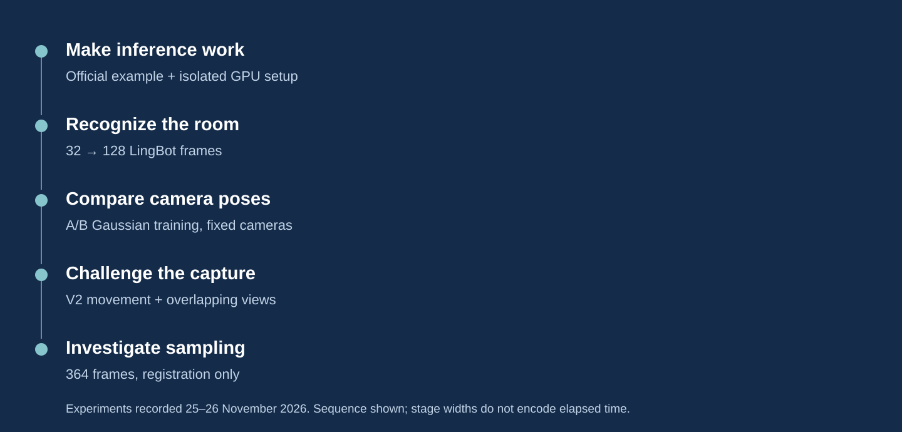

*Experimental order, not a duration plot. The investigation moved from “does inference execute?” to “what evidence would justify the next stage?”*

1. **Establish a baseline.** A small official example exposed a host-memory failure during checkpoint loading. A separate memory-mapped loading adapter allowed inference without editing model internals.
2. **Inspect an actual room.** Increasing LingBot input from 32 to 128 frames revealed more of the room, while fragmented surfaces remained.
3. **Compare cameras fairly.** LingBot and COLMAP poses were passed to the same small gsplat trainer with matched views and settings.
4. **Challenge the recording.** V2 introduced more physical movement and overlapping views. Its 128-frame experiment did not improve the connected registration rate.
5. **Test sampling.** A 364-frame, approximately 4 FPS experiment connected 235 cameras into one COLMAP model. No new Gaussian training followed that result.

## A recognizable room is only the beginning

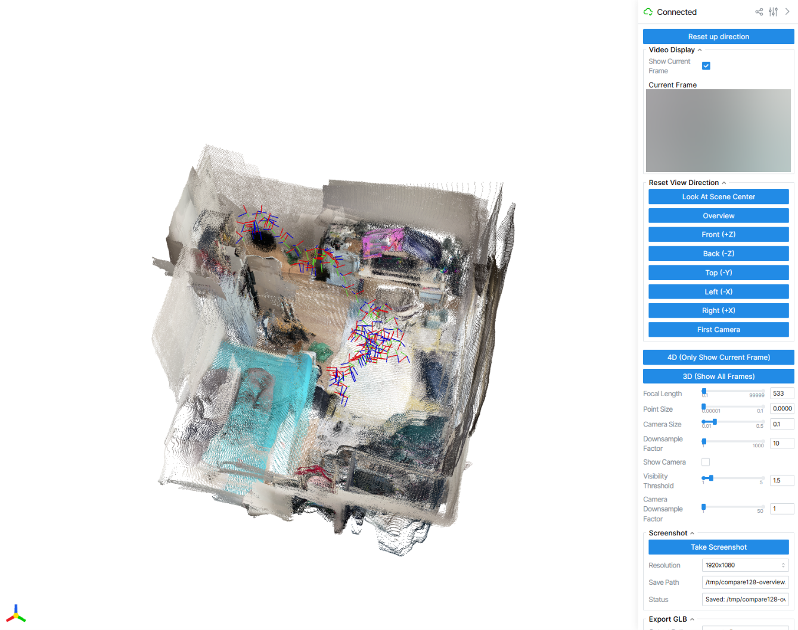

*User-supplied viewer screenshot. Only the real-photo reference thumbnail at the top right was strongly blurred for privacy; the reconstructed geometry, camera markers and remaining UI pixels are unchanged.*

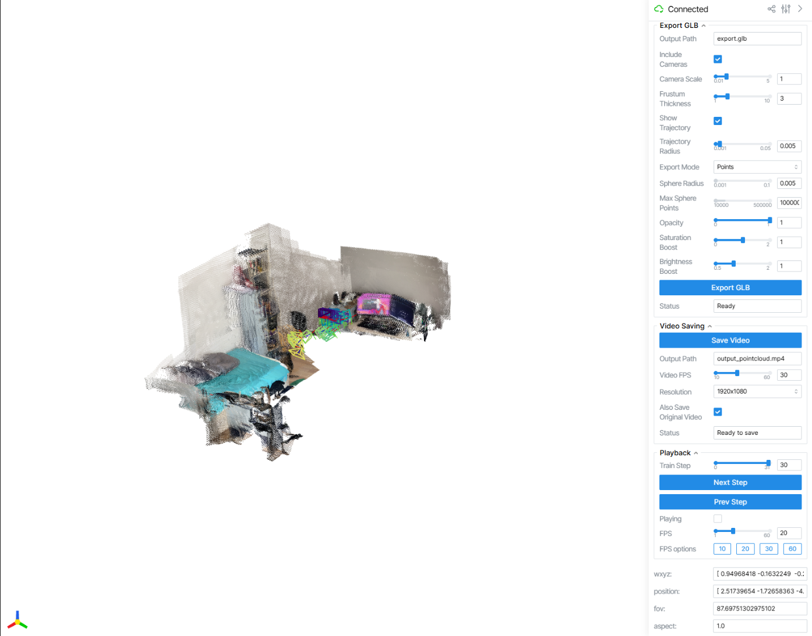

*Second user-supplied screenshot, shown without pixel changes. These captures use different views/display states and are not a controlled same-camera before/after pair. The viewer's “Export GLB” controls do not establish that an editable mesh or GLB was exported.*

<strong>Controlled same-camera computer-region crops</strong>

<table>
<tr><th>LingBot · 32 frames</th><th>LingBot · 128 frames</th></tr>
<tr><td>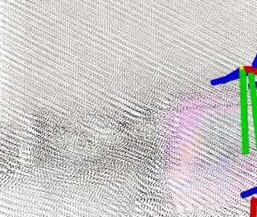</td><td>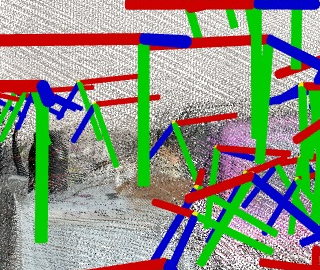</td></tr>
</table>

*Exact same-camera computer-region privacy crops. Fine dots are geometry; the colored lines are camera axes, not reconstructed surfaces. These narrow crops do not display the additional room regions discussed below.*

**What the real local inspection showed:** 128 frames added the bed, cupboard, floor and side regions that were poorly represented in the first 32-frame view. Gaps, layered surfaces and warped planes persisted. The first 32 frames' predictions were unchanged in the longer run; extra frames did not retrospectively repair that region.

The depth-derived cloud grew from **487,259 to 1,938,221 points**. This was increased coverage, not evidence of a clean room mesh or more accurate global alignment. The controlled cropped pair inside the disclosure uses the same first camera and viewer settings; the larger user-provided screenshots above are separate views.

<strong>What was actually exported?</strong>

LingBot outputs include predicted intrinsics, W2C and C2W transforms, RGB, depth and raw depth confidence. The adapter preserves frame ordering and nominal timestamps. This inference path did not provide a direct world-point prediction head, so the cloud was explicitly derived by unprojecting depth with the predicted cameras.

The saved matrices passed structural validation. Neither matrix validity nor finite depth proves physical accuracy, true metric scale or correct surface alignment.

## Two camera pipelines, one renderer

The next experiment kept the renderer fixed and changed the camera source.

~~~mermaid
flowchart TD
    V["Same selected phone-video frames"] --> I["Shared 768 × 432 RGB"]
    V --> L["LingBot-Map inference"]
    L --> A["A: predicted K and camera poses"]
    I --> C["COLMAP feature matching and SfM"]
    C --> B["B: registered K and camera poses"]
    A --> S["Same gsplat trainer"]
    B --> S
    I --> S
    S --> E["Held-out RGB + novel-view inspection"]
~~~

**A does not secretly run COLMAP.** Both routes use fixed external poses. The shared trainer uses the same seed, random initialization, 4,000 steps and image resolution. A single global similarity transform places the COLMAP model into the comparison coordinates; it does not correct individual cameras or hide drift.

The calibrations are not identical: A uses per-frame predicted intrinsics; B refines a shared PINHOLE camera. Real distortion, rolling shutter and stabilization are not calibrated here.

### V1: COLMAP poses gave the stronger visual candidate

*The complete held-out contact sheet is withheld because it reveals the private room. The aggregate scores below remain the original full-view measurements.*

*Both models used the same 38 registered views: 33 training and five held-out RGB views. In local inspection, B generally retained bed and furniture edges more coherently; both showed floaters and smeared regions.*

A reached **15.60 dB PSNR / 0.581 SSIM**; B reached **18.18 dB / 0.690**. This supports B as the visual candidate within this cohort. It does not establish a geometrically accurate room.

### Equipment detail: genuine Gaussian output, training view

<table>
<tr><th>Input RGB</th><th>A · LingBot poses</th><th>B · COLMAP poses</th></tr>
<tr><td>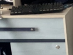</td><td>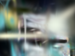</td><td>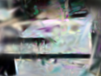</td></tr>
</table>

*These are unchanged pixel crops from training view125, restricted to the keyboard/desk area. They are not held-out evidence, novel views, or a basis for the reported PSNR/SSIM. The visible blur and artifacts are actual model output.*

### V2: more movement did not automatically make a better model

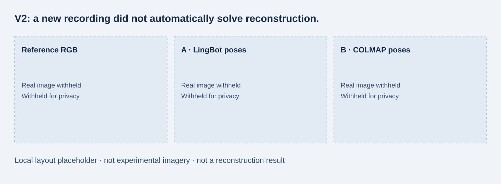

*The second video was 90.78 seconds at 1920 × 1080 and approximately 29.97 FPS. The initial experiment used 128 frames spread across it, about 1.4 FPS. The largest connected COLMAP model was still only 38/128.*

With **32 training views and six held-out views**, V2 A reached **12.90 dB / 0.542**, while V2 B reached **14.67 dB / 0.605**. B was generally more readable, particularly around the cupboard, but was not superior on every frame.

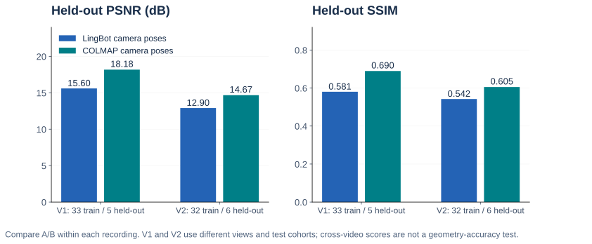

**Read this chart within each recording.** V1 and V2 have different views and test cohorts. Cross-video score differences are not a controlled geometry-accuracy measurement. Held-out RGB was excluded from Gaussian training, but camera estimation could use those images: this is pose-assisted image holdout, not an independent camera-ground-truth test.

### What happens outside the captured view?

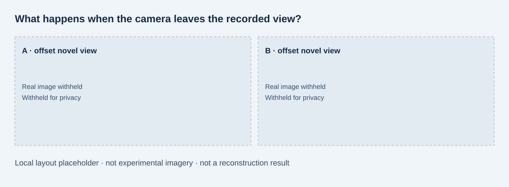

*For V2, both models were actually rendered after a local translation of 0.06 normalized units and a 0.12 radian rotation from the same source-frame index. Each uses its own estimated camera, so these are not the same world-space pose. No ground-truth image exists for the offset.*

Furniture remained recognizable, but blur, colored floaters and broken surfaces became obvious. A plausible recorded view can coexist with a fragile 3D representation.

## The turning point was frame sampling

V2's poor registration suggested a different question: **had the 128-frame cap made the sequence too sparse to connect reliably?**

I separated camera registration from rendering and extracted **364 chronologically ordered frames at approximately 4 FPS**. The time-controlled set retained every previous image, pixel-for-pixel at the shared resolution. The maximum sampling gap fell from **0.734 to 0.367 seconds**.

A second set selected a sharper image within ±0.10 seconds of each slot. It retained every time slot instead of taking the sharpest images globally; its maximum gap was **0.534 seconds**.

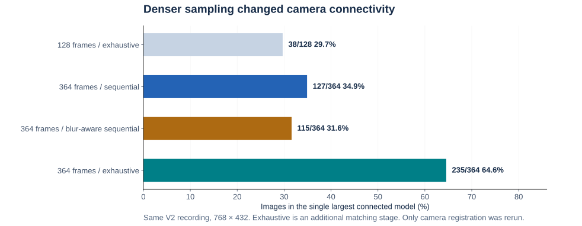

**The key result is not just 235 instead of 38 cameras.** The connected fraction increased from **29.7% to 64.6%**, and the same 128-image control improved from **38 to 82 registered images**. This shows better connectivity rather than merely a larger input set.

Dense sequential matching connected **127/364** views. Extending its database to exhaustive matching connected **235/364**. Neighboring-frame geometric match availability rose from **66.1% to 85.1%**. This is a correspondence proxy, not actual overlap area.

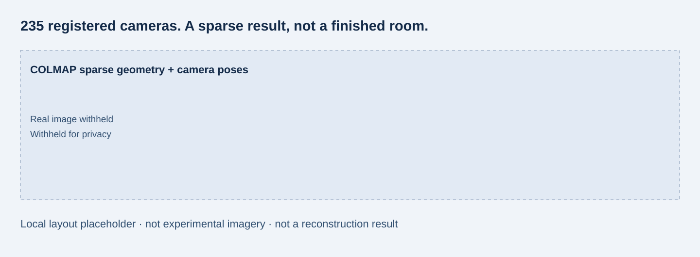

*The genuine local result contains 235 cameras and 18,008 sparse points. It is a COLMAP sparse reconstruction. It has not been trained into a new Gaussian scene, converted to a mesh, or exported as GLB.*

### Did blur explain the failures?

Lower-sharpness pairs were less likely to match, so blur is a plausible contributor. But the blur-aware sequential alternative registered **115/364 (31.6%)**, below ordinary dense sequential sampling at **127/364 (34.9%)**. Raising a sharpness score alone did not improve this result.

The blur-aware alternative was not exhaustively matched. Its sequential result is not an equivalent exhaustive test. Density, temporal matching range, calibration and true parallax are not fully isolated causes.

The successful dense model still excludes the first **15.25 seconds** and has a **10.61-second gap** between registered views. Better registration is useful; it is not complete room coverage.

## What did it cost to run?

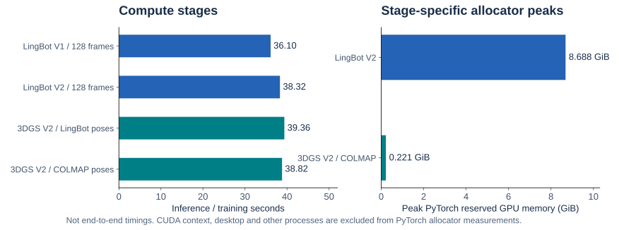

The experiments used an **RTX 4060 Ti with 16 GB VRAM**, Windows and isolated Linux GPU Docker containers. Host RAM was approximately 16 GB. The Workplace Studio Docker setup, drivers and system packages were unchanged.

- **LingBot V1 / 128 frames:** 36.10 seconds inference; 158.77 seconds including decoding, loading and export.
- **LingBot V2 / 128 frames:** 38.32 seconds inference; 213.86 seconds total; about 8.69 GiB peak PyTorch reserved memory.
- **V2 Gaussian training:** 39.36 seconds for A, 38.82 seconds for B; approximately 0.221 GiB reserved in each training process. These small fixed-view runs are not a production-quality limit.
- **Dense COLMAP:** 91.13 seconds sequential plus 441.49 seconds exhaustive extension, about 8 minutes 53 seconds combined. Frame preparation took 56.45 seconds. COLMAP matching used CPU.

**These memory figures are allocator measurements, not total device usage.** CUDA context, the desktop and other processes are excluded. Headless rasterizer throughput is not Unity frame rate, VR stereo performance or end-to-end viewer performance.

## What the evidence supports

**Tested:** isolated local inference; raw prediction export; camera-format checks; local point-cloud and Gaussian visualization; matched A/B Gaussian runs; denser COLMAP registration; preservation of videos and prior results.

**Supported interpretation:** COLMAP poses were the stronger visual candidate within the matched cohorts. Sparse sampling was an important part of V2's connectivity problem. More frames helped when they bridged the sequence; selecting sharper frames alone did not solve it.

**Not established:** camera ground-truth accuracy, metric scale, watertight geometry, consistent wall planes, stable arbitrary-view quality, editable equipment, collision, navigation mesh, GLB export or Unity/VR integration.

The experiment uses a small local gsplat adapter, random initialization and 4,000 steps. It is not a reproduction of the official reference trainer's best-quality benchmark and does not define these methods' maximum attainable quality.

## A possible path toward Workplace Studio

Next, inspect the **235-camera sparse model** for spatial coherence and missing regions before another Gaussian run. A bounded rendering pilot could follow that validation.

A future training environment needs distinct layers:

~~~mermaid
flowchart TD
    R["Validated camera reconstruction"] --> G["Visual layer: possible Gaussian rendering"]
    R --> M["Separate measured geometry or proxy mesh"]
    M --> N["Colliders and navigation validation"]
    X["Curated, licensed equipment assets"] --> T["Semantic objects and interaction logic"]
    G -. "future integration" .-> U["Unity / Windows / VR training environment"]
    N -. "future integration" .-> U
    T -. "future integration" .-> U
~~~

A visual splat layer could preserve appearance. Separate measured geometry would support collision and navigation. Licensed equipment models would carry IDs, controlled transforms and interaction logic. All layers need a shared, validated coordinate system and scale.

**This is a proposal, not an implemented pipeline.** A Gaussian PLY is neither an editable polygon mesh nor a collection of interactive devices.

## Reproduce the investigation

The research story is on this page. These notes support it without replacing it:

- [Methods, calibration and fair-comparison limits](research/monocular-3d-reconstruction/technical/METHODS.md)
- [Measured experiments and evidence provenance](research/monocular-3d-reconstruction/technical/EXPERIMENTS.md)
- [Reproduction requirements and bounded commands](research/monocular-3d-reconstruction/technical/REPRODUCIBILITY.md)
- [Image review, privacy boundary and publication status](research/monocular-3d-reconstruction/technical/PRIVACY_REVIEW.md)
- [Limitations and the next experiment](research/monocular-3d-reconstruction/technical/LIMITATIONS_AND_NEXT.md)

[Aggregate measurements](research/monocular-3d-reconstruction/data/results.json) and [source-record hashes](research/monocular-3d-reconstruction/data/evidence-sources.json) identify the actual metric records without distributing private media or raw geometry.

### Research software and attribution

[LingBot-Map](https://github.com/Robbyant/lingbot-map/tree/b9dd1b1de535e6d36e777fb42b8433c781bfd783) · [COLMAP](https://colmap.github.io/) · [gsplat 1.5.3](https://github.com/nerfstudio-project/gsplat/tree/937e29912570c372bed6747a5c9bf85fed877bae)

Version pins and license caveats are in the methods notes. Upstream code, model weights and datasets are not republished here.

---

This experimental branch does not change the application on main, promise a production reconstruction feature, or publish a separate GitHub Pages site.
