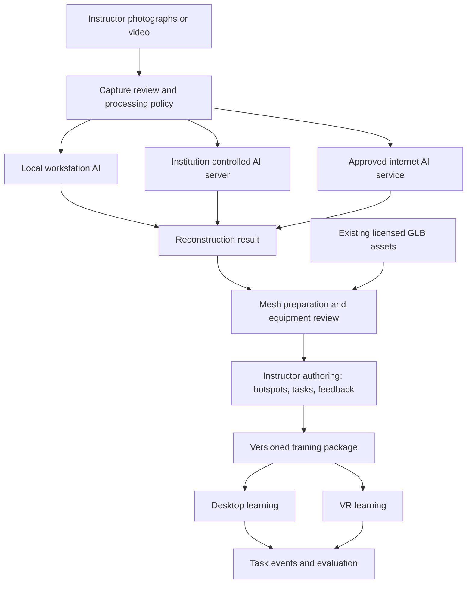

# Workplace Studio Literature and Technology Review

**A 3D Training Authoring Platform with Local and Online AI Processing**

**University:** Çankaya University - Faculty of Engineering, Computer Engineering Department 
**Project:** Interactive VR Simulation (Workplace Studio) 
**Course:** CENG 407 — Innovative System Design and Development I 
**Academic year:** 2026-2027 Fall 
**Date:** 15 November 2026 
**Initial application domain:** Introductory nursing education and equipment familiarization 
**Project repository:** [CankayaUniversity/ceng-407-408-2026-2027-Interactive-VR-Simulation](https://github.com/CankayaUniversity/ceng-407-408-2026-2027-Interactive-VR-Simulation) 
**Supervisor:** Gül Tokdemir

| Student number | Team member |
|---|---|
| 202111052 | Hasan DURMUŞOĞLU |
| 201911032 | Alperen KAHVECİ |
| 202111054 | Erdinç Bartu GÖKER |
| 202011027 | Arif Kaan YILMAZ |
| 202211016 | Yusuf ÇAĞLAYAN |
| 202111067 | Mehmet Yiğit İNCİ |

## Contents

- [Abstract](#abstract)
- [1 Introduction](#1-introduction)
- [2 Review Approach](#2-review-approach)
- [3 Simulation and Learning in Nursing Education](#3-simulation-and-learning-in-nursing-education)
- [4 Training Authoring and Interactive Equipment](#4-training-authoring-and-interactive-equipment)
- [5 Creating Environments from Photographs and Video](#5-creating-environments-from-photographs-and-video)
- [6 Technology and Deployment Options](#6-technology-and-deployment-options)
- [7 Comparison of Existing Approaches](#7-comparison-of-existing-approaches)
- [8 Synthesis and Proposed Project Direction](#8-synthesis-and-proposed-project-direction)
- [9 Evaluation and Limitations](#9-evaluation-and-limitations)
- [10 Conclusion](#10-conclusion)
- [References](#references)

## Abstract

Workplace Studio is a graduation project intended to connect environment creation, instructor authoring, and interactive training within a reusable 3D platform. Its initial domain is the orientation of novice nurses to a patient room and common equipment. The complete project scope includes generating environments from photographs or video with AI assistance, preparing interactive assets, allowing instructors to define educational content, and delivering training through desktop interaction and, subsequently, virtual reality. Both local and internet-connected processing are planned: privacy-sensitive institutions should be able to retain their data on controlled infrastructure, while other users may choose remote AI services. This review examines evidence on virtual nursing education, authoring tools, image-based reconstruction, runtime technologies, and deployment trade-offs. The literature supports investigating virtual training while showing that immersion, satisfaction, and clinical competence are distinct outcomes. Reconstruction methods also differ substantially in representation and editability; visual realism alone does not establish that a model is suitable for procedural interaction. The proposed direction therefore separates reconstruction, asset preparation, instructional logic, presentation, and processing policy. The expected contribution is an evaluated integration of these capabilities for a focused nursing use case, rather than a new reconstruction algorithm or a claim of demonstrated clinical effectiveness.

**Keywords:** nursing education; training authoring; virtual simulation; 3D reconstruction; photogrammetry; virtual reality; local AI; online AI.

## 1 Introduction

Training in a clinical environment combines recognizing equipment, understanding its purpose, locating controls, and responding appropriately to changes in state. A virtual patient room offers a setting in which these components can be introduced and repeated before supervised practice. Broader research on technology-enhanced simulation provides a rationale for this approach, although evidence comparing simulation with no intervention does not establish superiority over every alternative teaching method [[1]](#ref-1).

Workplace Studio targets two users. An **instructor** prepares a room, selects relevant devices, annotates objects, and defines activities. A **learner** explores the resulting environment and completes the instructor's tasks. The initial pilot focuses on generic patient-room equipment: a patient monitor, an infusion pump, an adjustable bed, and a nurse-call unit. The objective is introductory recognition and interaction, not independent operation of clinical equipment or medication administration.

The longer-term platform is intended to support other training settings, but the graduation project's initial evaluation should remain grounded in nursing. Photograph- and video-based environment creation is an intended deliverable of the two-semester project, not merely an unrelated future possibility. Similarly, VR is part of the intended project outcome, with desktop controls providing the first development and evaluation stage.

Deployment is deliberately flexible. A user may process captured media on a workstation, on an institution-controlled server, or through an approved internet service. Selecting a desktop or browser interface is a separate decision from selecting where AI computation and storage occur. An installed client can use an online service, while a connected system can retain selected training functions locally. The review therefore evaluates data location, connectivity, and presentation independently.

The guiding questions are:

1. What does existing research establish about virtual nursing training, and what remains uncertain?
2. How can instructors create meaningful activities without programming every interaction?
3. Which reconstruction approaches can support the production of editable training environments from photographs and video?
4. How should local and online processing coexist without obscuring data movement?
5. Which technical boundaries support a desktop prototype and a subsequent VR implementation?

## 2 Review Approach

This report presents a **focused narrative literature and technology review**, with source discovery and verification conducted on 15 November 2026. It combines peer-reviewed research, original research project pages, technical specifications, and official product documentation. Searches covered nursing simulation, immersive versus desktop learning, VR authoring tools, structure-from-motion, neural scene reconstruction, local-first software, and deployment security. Representative queries included “clinical virtual simulation nursing randomized controlled trial,” “authoring tools for virtual reality experiences,” and “editable mesh reconstruction Gaussian splatting.”

Research was located through public web searches leading to publisher pages, PubMed records, author repositories, and research project sites. Technical capabilities were checked against official documentation. Sources were selected for direct relevance to a project component, identifiable publication information, and sufficient accessible material to support the associated claim. Foundational studies were retained alongside more recent reconstruction and nursing research. Previous student reports informed the document structure but are not used as scientific evidence.

The review does not report an exhaustive database search, a PRISMA selection process, or an independent meta-analysis. Access also varied: some studies were available as full articles, while others were inspected through abstracts or author-provided summaries. Claims about those sources are limited accordingly. Product descriptions indicate advertised capabilities rather than independently verified educational effectiveness. Comparisons below are analytical interpretations of the cited material, not results of a new product benchmark.

## 3 Simulation and Learning in Nursing Education

### 3.1 Evidence for virtual simulation

Foronda et al. reviewed 80 studies of virtual simulation in nursing education and reported that most supported its educational use, while identifying bias and methodological gaps [[2]](#ref-2). This provides a broad motivation for further development, but heterogeneous interventions and outcome measures make it inappropriate to assume that every virtual task produces the same benefit.

More directly, Padilha et al. conducted a randomized trial with 42 Portuguese nursing students. A screen-based clinical simulation group showed better knowledge outcomes immediately and at a two-month assessment, as well as higher satisfaction; self-efficacy did not differ significantly [[3]](#ref-3). Its relevance is that meaningful virtual learning can be investigated before headset delivery is available. Its small sample and particular clinical scenario limit generalization to our equipment-orientation tasks.

Liaw et al. compared virtual and live nurse–physician communication training with 120 medical and nursing students. They found no significant between-group difference in communication performance or teamwork attitudes [[4]](#ref-4). The study concerns team communication rather than device manipulation. Moreover, an absence of a significant difference should not be treated as proof that every form of virtual and physical training is equivalent.

A recent meta-analysis by Li et al. included 20 randomized trials involving 2,063 nursing students. It reported improvements in knowledge and self-efficacy, but no statistically significant pooled improvement in skill performance. The authors identified substantial heterogeneity and low or very low certainty for important outcomes [[5]](#ref-5). Taken together, these findings justify a focused educational prototype and cautious evaluation rather than a general claim that VR will improve clinical performance.

### 3.2 Immersion and instructional design

Higher presence is not identical to better learning. In a science-laboratory experiment involving 52 university students, Makransky, Terkildsen, and Mayer found greater presence but poorer learning and higher cognitive load in the immersive condition [[6]](#ref-6). This is not a nursing study, yet it challenges the assumption that a more immersive presentation is automatically more effective.

The Cognitive Affective Model of Immersive Learning connects presence and agency with factors including motivation, cognitive load, and self-regulation [[7]](#ref-7). For Workplace Studio, the design implication is to keep the learner's task clear: highlight a relevant region when needed, provide concise explanations, and introduce complexity progressively. A room filled with labels, animations, and interface panels may compete with the material being taught.

Desktop and VR experiences should therefore share learning objectives while using suitable interaction methods for each medium. Keyboard-and-mouse navigation can support early testing, but VR requires separate attention to reach, readable spatial interfaces, locomotion, and comfort. Educational comparisons should distinguish knowledge, task accuracy, confidence, and perceived usability rather than collapsing them into a single success score.

### 3.3 Implications for the nursing pilot

The first pilot should evaluate whether learners can identify equipment, locate a control, explain its basic function, and complete a small set of approved simulated actions. A generic model is appropriate for this bounded objective only when its simplifications are made explicit and checked by a nursing educator. It should not be presented as training for a particular manufacturer's interface.

An initial activity might ask a learner to identify a patient monitor and recognize that its displayed values are illustrative. A subsequent activity could demonstrate how a pump's simulated power, door, and running states interact. These examples describe software learning tasks, not clinical operating instructions. Training content and assessment criteria must be approved before drawing conclusions about professional readiness.

## 4 Training Authoring and Interactive Equipment

### 4.1 Authoring as a distinct problem

Building a 3D environment and enabling an instructor to maintain it are different engineering tasks. Coelho et al.'s review of 29 VR-authoring studies found that evaluation commonly addressed usability, effectiveness, efficiency, and satisfaction, but relatively few studies used established questionnaires or specialist users [[8]](#ref-8). Consequently, instructor evaluation should be a first-class part of our project rather than an assumption derived from the learner interface.

A useful instructor workflow must connect educational intent to observable actions. The instructor should be able to identify an object, attach an explanation, define an expected action, set completion conditions, and preview the resulting activity. More complex branching can follow after a small reliable sequence works.

### 4.2 Hotspots and stateful interaction

A hotspot is useful for directing attention and opening contextual information, but procedural training requires additional semantics. A device needs a stable identity, supported actions, and a state that changes in response to those actions. A lesson then interprets those changes against its objectives.

VR Builder provides an existing example of this separation: its process model uses steps, behaviors, conditions, and transitions to represent training flows [[9]](#ref-9). The transferable principle is that geometry, interaction capabilities, and lesson progression should not be fused into one hard-coded scene. This does not imply that Workplace Studio must adopt VR Builder itself.

For our platform, a device action such as `TogglePower` should remain meaningful regardless of whether it originates from a mouse, a controller ray, or a direct VR interaction. Lesson logic can subscribe to the action and decide whether to advance, provide feedback, or record an attempt. A visual click alone should not be interpreted as evidence that a physical skill has been mastered.

### 4.3 Existing healthcare authoring systems

UbiSim advertises a nursing-focused editor for customizing scenarios, equipment, dialogue, patient characteristics, and educational content without coding [[10]](#ref-10). Oxford Medical Simulation describes screen-based and VR delivery alongside scenario customization through OMS Create [[11]](#ref-11). These systems demonstrate that instructor customization and multiple delivery modes already exist. Our contribution cannot reasonably be described as inventing either capability.

The project instead investigates a narrower integration: moving from user-captured spaces or supplied GLB assets to editable equipment activities, while allowing the institution to choose a processing location. Whether this combination reduces authoring effort or meets institutional needs must be evaluated. Public documentation reviewed here does not establish unrestricted custom mesh import, photograph-to-interactive-room generation, or a complete offline deployment configuration for either commercial product.

### 4.4 Guided assistance

Piko is the project's visual assistant. Its planned educational role is to deliver contextual prompts and feedback while preserving learner agency. Instructor-authored hints provide an appropriate initial baseline. Generative dialogue, if added, should be distinguished from authoritative lesson content and evaluated separately for incorrect or unsupported guidance. AI-assisted reconstruction remains a central AI component even if conversational assistance is limited in the initial implementation.

## 5 Creating Environments from Photographs and Video

### 5.1 Capture and reconstruction objectives

The intended workflow allows an instructor to record an environment using a phone or another imaging device. Video provides a sequence from which frames can be selected; photographs provide an image collection directly. A capture should cover relevant surfaces from multiple viewpoints rather than assuming that one image reveals the complete room.

The reconstruction objective is also broader than producing an attractive screenshot. The resulting training environment needs usable scale, navigable surfaces, recognizable devices, readable controls, and a practical path to interaction. These requirements motivate comparing geometric reconstruction and view-synthesis methods separately.

### 5.2 Structure-from-motion and multi-view stereo

Schönberger and Frahm's structure-from-motion work addresses reconstruction from unordered image collections and underpins the open-source COLMAP system [[12]](#ref-12). COLMAP's documented workflow estimates cameras and sparse structure before dense reconstruction and surface recovery. Its capture guidance emphasizes visual overlap, varied viewpoints, stable illumination, and textured surfaces; plain walls and reflections can be problematic [[13]](#ref-13).

For Workplace Studio, this is a useful geometric baseline with an explicit preparation pipeline. A photographed hospital room may contain blank walls, glossy equipment, occluded surfaces, and changing displays, so successful reconstruction should be measured rather than assumed. Scale checks, cleanup, and device replacement may remain necessary after reconstruction. The classical pipeline is a baseline for the AI component, not a claim that all photogrammetry is itself a learned AI method.

### 5.3 Neural radiance fields and Gaussian splatting

NeRF represents a scene as a continuous function of position and viewing direction, optimized from posed images to synthesize new views [[14]](#ref-14). Its primary representation is therefore different from an authored scene of independent mechanical parts. Mesh extraction is possible, but an extracted surface does not by itself specify which component is a button or how it should behave.

Kerbl et al.'s 3D Gaussian Splatting represents scenes using optimized anisotropic Gaussians and a fast renderer [[15]](#ref-15). It is relevant to visual fidelity and interactive viewing, but its published rendering results should not be treated as guaranteed performance on our target workstation or headset. A splat representation is not automatically the same asset as a conventional polygonal GLB scene.

SuGaR explicitly addresses extracting editable meshes from Gaussian representations and binding Gaussians to those surfaces [[16]](#ref-16). This demonstrates an important bridge between reconstruction and editing. Nevertheless, mesh recovery, equipment-part separation, collision preparation, and procedural behavior remain separate acceptance criteria for our platform.

### 5.4 Learned geometric reconstruction

DUSt3R predicts 3D structure from images without requiring the conventional sequence of independently solved geometric stages; its formulation supports reconstruction without prior camera calibration or poses [[17]](#ref-17). VGGT further investigates feed-forward inference of camera parameters, depth, point maps, and point tracks from image collections [[18]](#ref-18). These approaches are candidates for the project's AI reconstruction stage, not selected components with established performance in the current prototype.

Published results motivate experimentation, but the choice should also consider input coverage, memory use, installation complexity, licensing, output conversion, and failure behavior. Producing a point map rapidly is not equivalent to delivering a textured, correctly scaled, interaction-ready room. Missing or uncertain areas should be marked for review rather than silently filled with invented equipment details.

### 5.5 From reconstructed appearance to training assets

The project adopts mesh/GLB as its initial interchange boundary. The glTF specification defines scene hierarchies, meshes, materials, and animation, while GLB provides a binary container [[19]](#ref-19). This enables a common asset boundary across manually prepared and reconstructed environments; it does not define nursing procedures or application-specific scoring.

Blender's glTF tooling supports object and skeletal animation workflows, but not every Blender feature transfers through the format [[20]](#ref-20). An asset-preparation stage should therefore verify pivots, hierarchy, animation export, textures, and naming. A practical hybrid strategy is to reconstruct the room shell and static background while replacing important equipment with separately authored, licensed models. The instructor can then verify the correspondence between the captured layout and the editable scene.

**Table 1. Reconstruction approaches interpreted against the training requirements.**

| Approach | Representation or contribution | Potential use | Additional work before procedural training |
|---|---|---|---|
| SfM/MVS and COLMAP [[12]](#ref-12), [[13]](#ref-13) | Camera recovery, point clouds, surface reconstruction | Geometric baseline for a captured room | Texture/mesh preparation, scale checks, part separation, collision review |
| NeRF [[14]](#ref-14) | Neural radiance field and novel-view synthesis | Investigating visual reconstruction | Mesh conversion or a suitable renderer; explicit interaction assets |
| 3D Gaussian Splatting [[15]](#ref-15) | Gaussian scene representation and rendering | Visual reconstruction and scene viewing | Representation support, collision surfaces, editable device components |
| DUSt3R and VGGT [[17]](#ref-17), [[18]](#ref-18) | Learned geometric predictions | AI-assisted reconstruction candidates | Validation, fusion/meshing, texturing, scaling, runtime packaging |
| SuGaR [[16]](#ref-16) | Surface-aligned Gaussians and mesh extraction | Investigating an editing bridge | Device semantics, behavior bindings, export and performance checks |
| Manual or hybrid preparation [[20]](#ref-20) | Explicitly authored meshes and moving parts | Reliable pilot assets and corrections | Modeling effort, licensing, educator review of representational fidelity |

No approach has yet been benchmarked by the team as an end-to-end photograph/video-to-training pipeline. The table identifies investigation priorities rather than ranking methods by unmeasured performance.

## 6 Technology and Deployment Options

### 6.1 Runtime and presentation

Unity is the current desktop implementation platform. Its XR Interaction Toolkit defines interactors, interactables, and an interaction manager, offering a relevant abstraction for later controller-driven interaction [[21]](#ref-21). OpenXR supplies a cross-platform API boundary for XR runtimes [[22]](#ref-22). These capabilities support a development path, but they do not remove the need to build and test VR-specific interfaces, locomotion, and device bindings.

Godot also documents an XR architecture and OpenXR integration [[23]](#ref-23), so XR support alone does not uniquely justify Unity. For this project, retaining Unity is a continuity decision: an existing desktop prototype, C# domain logic, imported assets, and team development work can be extended rather than replaced. This is a project-specific rationale rather than a general engine-performance claim.

The earlier browser prototype remains relevant to internet-accessible delivery and authoring. However, the following decisions should not be conflated:

- **Presentation:** native desktop application, browser interface, or headset experience.
- **Processing:** workstation, institution-controlled server, or external online service.
- **Storage and sharing:** local project package, managed institutional storage, or an explicitly selected online repository/service.

**Table 2. Runtime options and project-specific trade-offs.**

| Option | Basis for consideration | Main issue to evaluate | Project direction |
|---|---|---|---|
| Unity native runtime [[21]](#ref-21), [[24]](#ref-24) | Current C# application; runtime glTF loading and an XR integration path | Installer/dependency management, rendering budgets, usable VR presentation | Continue as the primary training runtime |
| Godot native runtime [[23]](#ref-23) | Documented XR interfaces and OpenXR support | Migration effort and compatibility with the team's existing content and code | Recognized alternative; no migration proposed by this review |
| Existing browser prototype | Prior project implementation and accessible browser delivery | Consistency of lesson data, browser/device constraints, local file and permission behavior | Potential complementary client; production feature parity is not established |

### 6.2 Local and online AI execution

Cloud computing provides remotely accessible pools of computing resources, with several deployment models rather than a single public-service arrangement [[25]](#ref-25). Local-first software research similarly shows that offline capability and connected functionality need not be mutually exclusive [[26]](#ref-26). Workplace Studio should support a choice of processing policy instead of treating internet connectivity as mandatory or prohibited for every user.

Three planned operating profiles clarify this choice:

| Profile | AI execution and data boundary | Benefit sought | Constraint or acceptance test |
|---|---|---|---|
| Local workstation | Captures and reconstruction jobs remain on the selected computer | Direct control over sensitive media and operation without an external service | Provision dependencies/model weights in advance; test with networking disabled; measure GPU/RAM requirements |
| Institutional server | Approved clients use a server controlled by the institution, such as over a local network | Shared compute under institutional administration | Authentication, access separation, transport protection, administrator-managed retention; distinct from fully offline operation |
| Internet-connected service | A user explicitly selects an approved remote processing endpoint | Access to remote compute and easier centralized processing | Show what is uploaded, destination and retention; handle cost, latency, failed jobs, and deletion requirements |

The selected profile should be recorded with each reconstruction job. Local-only work must not silently fall back to an internet provider when memory is insufficient. The user should instead see a failure or an explicit choice to change the policy. Conversely, users who permit remote processing should not be forced to install every large model locally. These are proposed requirements, not implemented capabilities of the current client.

AI integration should return an environment package with geometry, textures, scale information, processing provenance, and validation status. The training runtime then consumes the approved package without depending on the reconstruction algorithm. Long-running reconstruction should expose progress, cancellation, and recoverable errors rather than block the application's interface.

ONNX Runtime illustrates cross-language deployment options, including C# integration and hardware-specific execution providers [[27]](#ref-27). It is a candidate where a selected model can be exported and validated; it does not establish that every reconstruction model can run inside Unity or within consumer GPU memory. A separately managed Python worker is another architectural option. The final decision must follow the AI team's measured model compatibility and resource requirements.

### 6.3 Portable assets and lesson data

Unity glTFast supports loading glTF assets at runtime [[24]](#ref-24), which is useful when instructors introduce environments after the application has been built. A common GLB boundary can therefore connect local files and downloaded reconstruction results. Application-specific lesson data should remain separate: asset references identify what exists, while objectives, conditions, and feedback describe what should be learned.

The proposed package should preserve stable device identifiers, moving-part references, contextual media, lesson versions, and source/licensing information. A downloaded package should pass the same structural and size checks as a local package. A content hash helps detect changes but does not establish that its creator is trusted or its clinical content is correct.

### 6.4 Privacy and security considerations

Captured clinical spaces may expose people, screens, documents, and institution-specific layouts. The capture workflow should therefore use approved spaces, minimize unnecessary content, and allow review before remote processing. Each online transfer needs a visible destination and an appropriate access policy; a generic “AI enabled” switch is insufficient to explain this boundary.

NIST's zero-trust architecture explicitly rejects treating network location alone as proof of trust [[28]](#ref-28). Accordingly, both local and connected profiles require controls appropriate to their assets: restricted file access, safe import paths, bounded processing, and protected credentials where services are used. NIST's AI Risk Management Framework provides a broader basis for documenting risks and evaluating trustworthy behavior throughout the AI lifecycle [[29]](#ref-29).

These references guide risk analysis; they do not certify the project. A local executable is not automatically private, and a public repository must not contain private room captures, credentials, patient information, or unlicensed model weights. Service and model licenses must be checked independently of whether computation is local or remote.

## 7 Comparison of Existing Approaches

**Table 3. Selected research and its relevance to Workplace Studio.**

| Work | Evidence or technical contribution | Important boundary | Consequence for the project |
|---|---|---|---|
| Foronda et al. [[2]](#ref-2) | Review of 80 virtual nursing simulation studies | Mixed interventions and methodological weaknesses | Select a specific learning objective and credible evaluation |
| Padilha et al. [[3]](#ref-3) | Randomized screen-based nursing study, 42 students | Small, scenario-specific sample | Desktop learning is a defensible starting point; test our own tasks |
| Liaw et al. [[4]](#ref-4) | Virtual/live communication comparison, 120 students | Communication outcome, not equipment handling | Match claims and assessment to the trained skill |
| Li et al. [[5]](#ref-5) | Recent nursing meta-analysis with domain-specific results | Heterogeneity and uncertain skill effects | Separate knowledge, self-efficacy, and observed performance |
| Makransky et al. [[6]](#ref-6) | More presence did not produce better learning in a science simulation | Non-nursing task and a particular design | Treat cognitive load as a design and evaluation concern |
| Coelho et al. [[8]](#ref-8) | Review of VR-authoring tools and evaluation practices | Limited specialist-user evaluation in the reviewed work | Recruit instructor input and assess authoring effort |
| DUSt3R/VGGT [[17]](#ref-17), [[18]](#ref-18) | Learned recovery of scene geometry and related attributes | Geometric predictions are not complete training packages | Evaluate preparation effort after AI inference |
| SuGaR [[16]](#ref-16) | Mesh extraction and editing bridge for Gaussian scenes | Does not supply clinical task semantics | Keep interaction authoring separate from reconstruction |

**Table 4. Existing systems and the proposed integration.**

| System or approach | Capability supported by the reviewed source | Relevance | Unestablished or additional requirement |
|---|---|---|---|
| UbiSim [[10]](#ref-10) | Nursing scenarios and instructor customization | Healthcare-specific authoring baseline | The reviewed page does not establish our complete capture-to-interactive-GLB workflow or local AI configuration |
| Oxford Medical Simulation [[11]](#ref-11) | Screen/VR training and scenario customization | Multiple delivery modes and educator control | Arbitrary reconstructed-asset import and the required deployment boundaries need separate confirmation |
| VR Builder [[9]](#ref-9) | Workflow steps, behaviors, conditions, and object bindings | Reference for procedural authoring | Nursing content, capture processing, and our package contract still need implementation |
| COLMAP [[13]](#ref-13) | Image-based reconstruction pipeline | Geometric reconstruction baseline | No nursing lesson editor or equipment behavior follows from reconstruction alone |
| Workplace Studio | Current local desktop editor and introductory equipment prototype | Starting implementation for the project | Photo/video AI, selectable local/online execution, full lesson assessment, and headset support remain project deliverables |

These comparisons do not prove that no existing product combines the desired features. They identify what the reviewed evidence establishes and which integration questions remain open for this graduation project. Vendor claims were not tested through product trials, and no pricing or performance ranking is inferred.

## 8 Synthesis and Proposed Project Direction

### 8.1 Integration problem and expected contribution

The literature suggests three connected engineering challenges. First, an effective simulation needs instructional structure beyond visual exploration. Second, reconstruction must be translated into assets that support meaningful interaction. Third, deployment must express where computation and data movement are permitted. Addressing one does not automatically solve the others.

The project's intended contribution is therefore a reusable authoring and delivery pipeline, demonstrated with introductory nursing tasks, in which instructors can prepare a captured or modeled environment and select an appropriate AI-processing location. The contribution is an integration and evaluation of existing methods. It does not require inventing a new reconstruction model, outperforming established commercial nursing simulators, or claiming complete automation from any arbitrary photograph.

*Figure 1. Intended end-to-end project workflow. The diagram describes the target integration, not the implementation status of every block. Internet access is a selectable processing path rather than a mandatory dependency of all training.*

### 8.2 Common interaction and lesson model

An action should be represented at the equipment level before a lesson decides what it means educationally. For example, a simulated pump can expose power, door, and running states. A lesson may ask for recognition of a control, demonstration of a permitted action, or explanation of why an action is unavailable. Its completion conditions should be inspectable by the instructor rather than inferred from an uncontrolled AI response.

The authoring layer should associate explanations and feedback with stable equipment identities. The presentation layer may animate a door or redraw a display, while the domain state remains consistent across desktop and VR. Piko can then explain the current learning objective using instructor-approved material. This separation also makes failures easier to diagnose: an incorrect device response, an invalid lesson condition, and a reconstruction error are different problems.

### 8.3 Current implementation and two-semester scope

The implementation status below is based on the project files accompanying this review. It is project context, not an externally validated research result.

| Component | Status at this review | Intended project development |
|---|---|---|
| Native desktop application | Unity application with keyboard/mouse navigation | Improve reliability and usability for the nursing pilot |
| Environment import and editing | Local GLB loading, areas/hotspots, and local project saving | Add the validated outputs of local and remote reconstruction jobs |
| Nursing equipment | Basic monitor, pump, bed, and nurse-call interactions | Educator-reviewed tasks and reusable behavior bindings |
| Lesson progression and assessment | Equipment state/events provide a starting point; complete authorable assessment is not implemented | Explicit tasks, conditions, feedback, and progress recording |
| Photograph/video reconstruction | No integrated end-to-end pipeline in the current application | Select and integrate an AI-assisted reconstruction workflow within the graduation project |
| Local/online processing choice | Current desktop content path is local; a selectable service layer is not implemented | Local workstation and internet-connected processing, with an institutional-server option where feasible |
| VR headset delivery | Not yet integrated | Device input, spatial UI, locomotion, and headset testing in the second semester |
| Piko assistance | Animated visual mascot | Contextual guidance; generative assistance only if appropriately scoped and evaluated |

During the first semester, the focus is the desktop authoring/training foundation and a bounded reconstruction integration experiment. The second semester extends the shared training logic to VR and completes the chosen AI-processing paths. The minimum end-to-end demonstration should include a captured room, reviewed geometry, at least one separately interactive device, an instructor-authored activity, and a learner attempt. Supporting every reconstruction family or every headset is outside that minimum scope.

## 9 Evaluation and Limitations

### 9.1 Technical and authoring evaluation

Evaluation should record the entire preparation pipeline, including manual correction, rather than only neural inference time. Reconstruction tests should document the capture device, number/resolution of images or selected frames, hardware, model/version, execution profile, processing time, peak memory, and failure cases. Geometry should be checked against a few measured distances and the visibility of task-relevant controls. Such checks are more directly related to our objectives than reporting novel-view image quality alone.

Instructor tasks should include importing a room, annotating a device, defining a short activity, previewing it, and saving/reopening the package. Completion, errors, time, and assistance requests provide observable measures. The System Usability Scale can supplement these observations [[30]](#ref-30). NASA-TLX offers a subjective workload instrument [[31]](#ref-31). Neither measure alone establishes learning effectiveness, and a usability score should not be reported as a percentage of clinical readiness.

Local and remote profiles should receive equivalent functional tasks. The test plan should include denied uploads in local-only mode, networking disabled after local dependencies are provisioned, remote-service interruption, cancellation, invalid output packages, and an unavailable or changed device binding. A successful remote job should produce the same documented package structure as a local job; this does not assume identical numerical output across hardware or model versions.

### 9.2 Educational evaluation

The pilot should use educator-approved objectives and distinguish novices from experienced participants. Candidate measures include equipment-identification accuracy, control-location errors, task-sequence errors, completion time, pre/post knowledge scores, and a delayed retention check if feasible. Confidence and satisfaction should be reported separately from observed performance.

Much of the cited nursing evidence concerns students rather than newly employed registered nurses. Transfer to workplace orientation must therefore be evaluated explicitly rather than assumed from student-study results.

A baseline could use conventional illustrated instructions or a simpler desktop activity matched for teaching content and time. Any later desktop/VR comparison should preserve those objectives while documenting differences in input and feedback. Recruitment, sample size, consent, and any required institutional approvals must be decided before data collection. A small convenience pilot can reveal usability problems, but should not be described as establishing clinical transfer or population-wide educational effectiveness.

### 9.3 Principal limitations

The proposed workflow faces incomplete captures, glossy surfaces, occlusion, inaccurate scale, and resource-intensive reconstruction. Generic equipment may simplify brand-specific controls. Manual preparation may remain substantial even when AI improves geometry recovery. Local and internet modes introduce different operational burdens, and service availability and licensing may change. These limitations require measured acceptance criteria rather than assumptions that one deployment mode or reconstruction method solves every case.

This review itself is selective rather than systematic, and some evidence was accessible only through abstracts or project summaries. Commercial features were reviewed from public documentation. No new user study, clinical validation, reconstruction benchmark, or certification is claimed. The nursing-room prototype demonstrates technical possibilities that still require instructional review and empirical evaluation.

## 10 Conclusion

Workplace Studio is positioned as a training authoring platform that joins AI-assisted environment creation with interactive equipment and structured learning. Nursing research motivates further investigation while showing that learning benefits depend on the task, instructional design, and measured outcome. Authoring tools demonstrate the value of explicit activities and editable scenarios. Reconstruction research offers several routes from photographs and video to scene representations, but interaction-ready assets require additional preparation and validation.

The resulting direction is a modular platform with a common training package and separate reconstruction, authoring, and presentation components. Both privacy-sensitive local processing and explicitly chosen internet processing belong to the planned scope. Desktop delivery provides the first implementation stage, and VR extends the same learning model through a separately evaluated interface. The project's contribution will be judged by whether this integration produces usable instructor workflows and credible introductory training activities, rather than by visual realism or feature count alone.

## References

Online technical and product sources were checked on **15 November 2026**. Numbered links in the text point to the corresponding entries below.

**[1]** D. A. Cook et al., “Technology-enhanced simulation for health professions education: A systematic review and meta-analysis,” *JAMA*, vol. 306, no. 9, pp. 978–988, 2011. DOI: [10.1001/jama.2011.1234](https://doi.org/10.1001/jama.2011.1234). [PubMed record and abstract](https://pubmed.ncbi.nlm.nih.gov/21900138/).

**[2]** C. L. Foronda, M. Fernandez-Burgos, C. Nadeau, C. N. Kelley, and M. N. Henry, “Virtual simulation in nursing education: A systematic review spanning 1996 to 2018,” *Simulation in Healthcare*, vol. 15, no. 1, pp. 46–54, 2020. DOI: [10.1097/SIH.0000000000000411](https://doi.org/10.1097/SIH.0000000000000411). [PubMed record and abstract](https://pubmed.ncbi.nlm.nih.gov/32028447/).

**[3]** J. M. Padilha, P. P. Machado, A. Ribeiro, J. Ramos, and P. Costa, “Clinical virtual simulation in nursing education: Randomized controlled trial,” *Journal of Medical Internet Research*, vol. 21, no. 3, e11529, 2019. DOI: [10.2196/11529](https://doi.org/10.2196/11529). [Corrected article](https://www.jmir.org/2019/3/e11529/).

**[4]** S. Y. Liaw, S. W. Ooi, K. D. B. Rusli, T. C. Lau, W. W. S. Tam, and W. L. Chua, “Nurse-physician communication team training in virtual reality versus live simulations: Randomized controlled trial on team communication and teamwork attitudes,” *Journal of Medical Internet Research*, vol. 22, no. 4, e17279, 2020. DOI: [10.2196/17279](https://doi.org/10.2196/17279). [Article](https://www.jmir.org/2020/4/e17279/).

**[5]** X. Li, Y. Hu, H. Peng, S. Luo, C. Yang, B. Luo, X. Wan, and Y. Li, “Effects of immersive virtual reality simulation on nursing students' learning outcomes: A systematic review and meta-analysis,” *Journal of Nursing Management*, vol. 2026, article 4686851, 2026. DOI: [10.1155/jonm/4686851](https://doi.org/10.1155/jonm/4686851). [Publisher article](https://onlinelibrary.wiley.com/doi/10.1155/jonm/4686851).

**[6]** G. Makransky, T. S. Terkildsen, and R. E. Mayer, “Adding immersive virtual reality to a science lab simulation causes more presence but less learning,” *Learning and Instruction*, vol. 60, pp. 225–236, 2019. DOI: [10.1016/j.learninstruc.2017.12.007](https://doi.org/10.1016/j.learninstruc.2017.12.007). [Publisher abstract](https://www.sciencedirect.com/science/article/pii/S0959475217303274).

**[7]** G. Makransky and G. B. Petersen, “The Cognitive Affective Model of Immersive Learning (CAMIL): A theoretical research-based model of learning in immersive virtual reality,” *Educational Psychology Review*, vol. 33, pp. 937–958, 2021. DOI: [10.1007/s10648-020-09586-2](https://doi.org/10.1007/s10648-020-09586-2). [Article](https://link.springer.com/article/10.1007/s10648-020-09586-2).

**[8]** H. Coelho, P. Monteiro, G. Gonçalves, M. Melo, and M. Bessa, “Authoring tools for virtual reality experiences: A systematic review,” *Multimedia Tools and Applications*, vol. 81, pp. 28037–28060, 2022. DOI: [10.1007/s11042-022-12829-9](https://doi.org/10.1007/s11042-022-12829-9). [Publisher abstract](https://link.springer.com/article/10.1007/s11042-022-12829-9).

**[9]** MindPort, “VR Builder,” official repository and process-authoring documentation. [Repository](https://github.com/MindPort-GmbH/VR-Builder). [Quick-start documentation](https://mindport-gmbh.github.io/VR-Builder-Documentation/articles/core/quick-start.html). Accessed: Nov. 15, 2026.

**[10]** UbiSim, “Intuitive Editor.” [Official product documentation](https://www.ubisimvr.com/intuitive-editor). Accessed: Nov. 15, 2026.

**[11]** Oxford Medical Simulation, “Platform.” [Official product documentation](https://oxfordmedicalsimulation.com/en-gb/platform/). Accessed: Nov. 15, 2026.

**[12]** J. L. Schönberger and J.-M. Frahm, “Structure-from-motion revisited,” in *Proceedings of the IEEE Conference on Computer Vision and Pattern Recognition*, pp. 4104–4113, 2016. [Paper and publication record](https://openaccess.thecvf.com/content_cvpr_2016/html/Schonberger_Structure-From-Motion_Revisited_CVPR_2016_paper.html).

**[13]** COLMAP contributors, “Tutorial,” *COLMAP Documentation*. [Official documentation](https://colmap.github.io/tutorial.html). Accessed: Nov. 15, 2026.

**[14]** B. Mildenhall, P. P. Srinivasan, M. Tancik, J. T. Barron, R. Ramamoorthi, and R. Ng, “NeRF: Representing scenes as neural radiance fields for view synthesis,” in *European Conference on Computer Vision*, 2020. [Author project page and paper](https://www.matthewtancik.com/nerf).

**[15]** B. Kerbl, G. Kopanas, T. Leimkühler, and G. Drettakis, “3D Gaussian splatting for real-time radiance field rendering,” *ACM Transactions on Graphics*, vol. 42, no. 4, 2023. [Author project page and paper](https://repo-sam.inria.fr/fungraph/3d-gaussian-splatting/).

**[16]** A. Guédon and V. Lepetit, “SuGaR: Surface-aligned Gaussian splatting for efficient 3D mesh reconstruction and high-quality mesh rendering,” in *Proceedings of the IEEE/CVF Conference on Computer Vision and Pattern Recognition*, 2024. [Author project page and paper](https://anttwo.github.io/sugar/).

**[17]** S. Wang, V. Leroy, Y. Cabon, B. Chidlovskii, and J. Revaud, “DUSt3R: Geometric 3D vision made easy,” in *Proceedings of the IEEE/CVF Conference on Computer Vision and Pattern Recognition*, 2024. [Author manuscript](https://arxiv.org/abs/2312.14132). [Official implementation](https://github.com/naver/dust3r).

**[18]** J. Wang, M. Chen, N. Karaev, A. Vedaldi, C. Rupprecht, and D. Novotny, “VGGT: Visual geometry grounded transformer,” in *Proceedings of the IEEE/CVF Conference on Computer Vision and Pattern Recognition*, 2025. [Author project page and paper](https://vgg-t.github.io/).

**[19]** The Khronos 3D Formats Working Group, “glTF 2.0 specification.” [Official specification](https://registry.khronos.org/glTF/specs/2.0/glTF-2.0.html). Accessed: Nov. 15, 2026.

**[20]** Blender Foundation, “glTF 2.0,” *Blender 5.2 LTS Manual*. [Official manual](https://docs.blender.org/manual/en/5.2/addons/scene_gltf2.html). Accessed: Nov. 15, 2026.

**[21]** Unity Technologies, “XR Interaction Toolkit,” version 3.0 documentation. [Official documentation](https://docs.unity3d.com/Packages/com.unity.xr.interaction.toolkit@3.0/manual/index.html). Accessed: Nov. 15, 2026.

**[22]** The Khronos Group, “OpenXR.” [Official overview](https://www.khronos.org/openxr/). Accessed: Nov. 15, 2026.

**[23]** Godot Engine contributors, “Setting up XR,” *Godot Engine Documentation*. [Official documentation](https://docs.godotengine.org/en/stable/tutorials/xr/setting_up_xr.html). Accessed: Nov. 15, 2026.

**[24]** Unity Technologies, “Unity glTFast documentation,” version 6.0 documentation. [Official documentation](https://docs.unity3d.com/Packages/com.unity.cloud.gltfast@6.0/manual/index.html). Accessed: Nov. 15, 2026.

**[25]** P. Mell and T. Grance, *The NIST Definition of Cloud Computing*, NIST SP 800-145, 2011. DOI: [10.6028/NIST.SP.800-145](https://doi.org/10.6028/NIST.SP.800-145). [NIST publication](https://csrc.nist.gov/pubs/sp/800/145/final).

**[26]** M. Kleppmann, A. Wiggins, P. van Hardenberg, and M. McGranaghan, “Local-first software: You own your data, in spite of the cloud,” in *Proceedings of the ACM SIGPLAN International Symposium on New Ideas, New Paradigms, and Reflections on Programming and Software (Onward!)*, 2019. DOI: [10.1145/3359591.3359737](https://doi.org/10.1145/3359591.3359737). [Author publication page](https://martin.kleppmann.com/2019/10/23/local-first-at-onward.html).

**[27]** ONNX Runtime contributors, “ONNX Runtime documentation.” [Official documentation](https://onnxruntime.ai/docs/). Accessed: Nov. 15, 2026.

**[28]** S. Rose, O. Borchert, S. Mitchell, and S. Connelly, *Zero Trust Architecture*, NIST SP 800-207, 2020. DOI: [10.6028/NIST.SP.800-207](https://doi.org/10.6028/NIST.SP.800-207). [NIST publication](https://csrc.nist.gov/pubs/sp/800/207/final).

**[29]** E. Tabassi, *Artificial Intelligence Risk Management Framework (AI RMF 1.0)*, NIST AI 100-1, 2023. DOI: [10.6028/NIST.AI.100-1](https://doi.org/10.6028/NIST.AI.100-1). [NIST publication](https://www.nist.gov/publications/artificial-intelligence-risk-management-framework-ai-rmf-10).

**[30]** J. Brooke, “SUS: A quick and dirty usability scale,” in *Usability Evaluation in Industry*, P. W. Jordan, B. Thomas, B. A. Weerdmeester, and I. L. McClelland, Eds., pp. 189–194, 1996. [Original chapter hosted by AHRQ](https://digital.ahrq.gov/sites/default/files/docs/survey/systemusabilityscale%2528sus%2529_comp%255B1%255D.pdf).

**[31]** NASA, “NASA Task Load Index (TLX).” [Official instrument and guidance](https://www.nasa.gov/human-systems-integration-division/nasa-task-load-index-tlx/). Accessed: Nov. 15, 2026.
